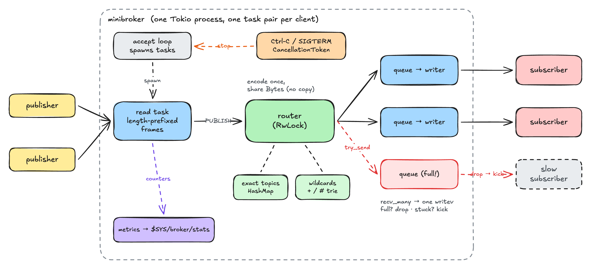
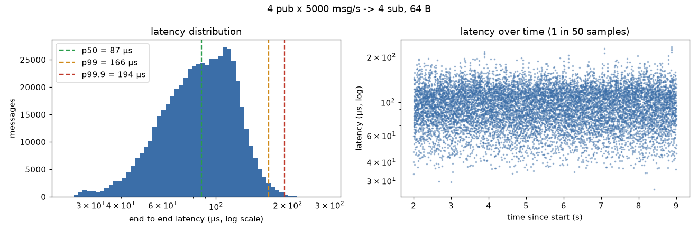
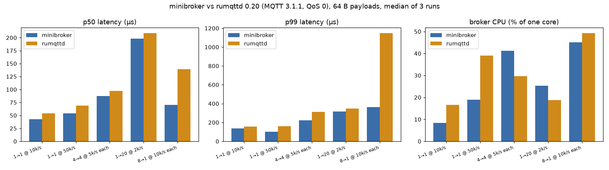

# minibroker

[](https://github.com/preeeetham/minibroker/actions/workflows/ci.yml)
[](https://minibroker.onrender.com)

A small, fast publish/subscribe message broker in Rust + Tokio, built as a
systems-programming project. It has a binary wire protocol, a fuzzed parser,
MQTT-style wildcard topics, backpressure for slow consumers, graceful
shutdown, and profiler-driven optimizations with before/after numbers.

**▶ Live demo: [minibroker.onrender.com](https://minibroker.onrender.com)**.
A simulated EV fleet streams through the real broker. You can subscribe with
wildcards, publish messages, and trigger a slow subscriber to watch the
broker cut it off without slowing anyone else. (Free hosting: the first visit
after a quiet spell takes ~30 s to wake up.)

* **[DECISIONS.md](DECISIONS.md)**: every design decision (74 of them), the
  alternatives considered, and why.
* **[DEBUGGING.md](DEBUGGING.md)**: real bugs found while building it, and
  how each was tracked down.
* **[docs/PROTOCOL.md](docs/PROTOCOL.md)**: the wire format, byte by byte.
* **[docs/LINUX.md](docs/LINUX.md)**: four experiments on how the OS shapes
  the broker (fd limits, Nagle, socket buffers, epoll).

## Architecture




* **One Tokio task per connection** reads and parses frames. A second
  task per connection owns the write half and drains a **bounded queue**.
  Nobody else touches a client's socket.
* **Publishes are encoded once.** Every subscriber's queue gets a
  reference-counted handle (`bytes::Bytes`) to the same buffer, so fan-out
  doesn't copy the payload.
* **Routing** uses an exact-topic `HashMap` plus a **trie for wildcard
  filters** (`+`, `#`) behind one `std::sync::RwLock`. Publishers only take
  the read lock, and the lock is never held across an `.await`.
* **Fan-out never blocks.** A full subscriber queue drops that message for
  that subscriber only. A subscriber that stays full is disconnected
  (`ERROR SlowConsumer`). One stalled client can't slow down anyone else.
* **The writer batches.** It takes everything already queued (up to 256
  frames) and sends it in a single vectored `writev`.

## Quick start

```bash
cargo build --release

# terminal 1: the broker
./target/release/minibroker

# terminal 2: subscribe (wildcards: + = one level, # = the rest)
./target/release/mb-cli sub 'vehicle/+/speed'

# terminal 3: publish
./target/release/mb-cli pub vehicle/42/speed 88

# broker's own live counters, published every 10 s
./target/release/mb-cli sub '$SYS/#'
```

`minibroker --help` lists every limit: queue size, slow-consumer drop
limit, max frame size, partial-frame timeout, max connections, listen
backlog, shutdown grace period.

## Performance

All numbers come from an Apple M4 Pro with release builds over loopback.
How they were measured, and the raw results, are in
[`bench/results/`](bench/results) and DECISIONS.md (P11–P14).

### Two profiler-driven optimizations (P12)

**1. Writer batching (`recv_many` + zero-copy `writev`).** `strace` showed
one `sendto` syscall per message per subscriber, and `perf` showed 70% of
broker CPU inside that syscall
([flamegraph before](bench/results/profile_before.flamegraph.svg),
[after](bench/results/profile_after.flamegraph.svg)).

| 64 B messages | before | after |
|---|---:|---:|
| Linux: write syscalls for 2 M deliveries | 2 000 010 `sendto` | **24 830 `writev`** |
| Linux: deliveries/s, 10 subscribers | 4.0 M | **5.9 M** |
| macOS: deliveries/s, 1 subscriber | 351 k | **2.55 M** (7.3×) |
| macOS: deliveries/s, 100 subscribers | 443 k | **13.3 M** (30×) |

**2. Wildcard filters in a topic trie.** Criterion showed routing cost grew
linearly with the number of wildcard subscriptions.

| wildcard filters | linear scan | trie |
|---:|---:|---:|
| 100 | 1.54 µs | 121 ns |
| 10 000 | 134 µs | **120 ns** (1 100×) |

### End-to-end latency (Python load generator, open-loop fixed rate)

`tools/loadgen.py` sends at a fixed rate and measures latency from both the
actual send time and the *scheduled* send time, so the results don't suffer
from coordinated omission.



| scenario (64 B) | delivered/s | p50 | p99 | p99.9 |
|---|---:|---:|---:|---:|
| 1 → 1 @ 10 k/s | 10 000 | 39 µs | 55 µs | 63 µs |
| 1 → 1 @ 50 k/s | 50 000 | 57 µs | 77 µs | 112 µs |
| 4 → 4 @ 5 k/s each | 80 000 | 87 µs | 166 µs | 194 µs |

### Compared with rumqttd (P14)

Same load generator, same machine, brokers alternated, median of 3 runs,
64 B payloads. minibroker speaks its own protocol and
[rumqttd](https://github.com/bytebeamio/rumqtt) 0.20 speaks MQTT 3.1.1 at
QoS 0. Both are driven by `tools/compare_rumqttd.py`.



| scenario | broker | delivered/s | lost | p50 µs | p99 µs | p99.9 µs | broker CPU | broker RSS |
|---|---|---:|---:|---:|---:|---:|---:|---:|
| 1→1 @ 10k/s | minibroker | 10,000 | 0 | 43 | 136 | 262 | 8% | 3.7 MB |
| 1→1 @ 10k/s | rumqttd | 10,000 | 0 | 54 | 158 | 283 | 17% | 32.6 MB |
| 1→1 @ 50k/s | minibroker | 50,000 | 0 | 54 | 102 | 208 | 19% | 3.8 MB |
| 1→1 @ 50k/s | rumqttd | 50,000 | 0 | 69 | 162 | 568 | 39% | 127.0 MB |
| 4→4 @ 5k/s each | minibroker | 80,000 | 0 | 88 | 222 | 513 | 41% | 4.0 MB |
| 4→4 @ 5k/s each | rumqttd | 80,000 | 0 | 98 | 312 | 1053 | 30% | 57.0 MB |
| 1→20 @ 2k/s | minibroker | 40,000 | 0 | 198 | 318 | 528 | 25% | 4.2 MB |
| 1→20 @ 2k/s | rumqttd | 40,000 | 0 | 209 | 348 | 595 | 19% | 16.3 MB |
| 8→1 @ 10k/s each | minibroker | 80,000 | 0 | 70 | 364 | 1331 | 45% | 4.0 MB |
| 8→1 @ 10k/s each | rumqttd | 80,000 | 0 | 139 | 1149 | 2835 | 49% | 198.6 MB |

**How to read this honestly:**
* **This isn't a like-for-like product comparison.** rumqttd implements full
  MQTT (QoS 1/2, keep-alives, sessions, auth, bridging, MQTT 5) on a
  commit-log router built for replay. minibroker is QoS 0 only.
* minibroker has **lower latency in every scenario**. The gap is largest with
  many publishers feeding one subscriber (8→1: p99 364 vs 1 149 µs).
* **CPU is mixed.** minibroker uses less CPU in 1→1 and 8→1, but *more* in the
  fan-out-heavy cases (4→4, 1→20). rumqttd's single router thread batches
  fan-out work, while minibroker routes on each publisher's own task.
* **RSS differs by 10–50×** (4 MB vs 16–199 MB). rumqttd keeps messages in
  commit-log segments (up to 100 MB × 10 in this config), which is what
  makes replay possible. minibroker holds nothing after delivery.


### Durability: what an fsync costs (P15)

Durable topics (`--data-dir data --durable 'fleet/#'`) go to a segmented,
CRC-checked, append-only log. A dedicated writer thread **group-commits**:
it appends everything that's waiting, then pays for one `fsync`.

| strategy (64 B records, M4 Pro SSD) | records/s |
|---|---:|
| fsync every record | ~290 |
| group commit of 1 024 | **~258 000** |
| never fsync | ~6 M |

At 10 k msg/s end to end, group commit adds no measurable latency (p99
269 µs vs 310 µs in-memory). Fsync-per-record can't keep up and holds
publishers back, which is exactly the trade-off the design makes visible. The log
survived 9 `kill -9` crashes mid-flood with contiguous offsets, and recovery
truncates torn writes (tested). `mb-cli replay 'fleet/#' --count 50` reads
history back.

### Micro-benchmarks (criterion)

| | |
|---|---:|
| decode one 256 B PUBLISH | 76 ns |
| decode 64 frames from one buffer | 22 M frames/s |
| route one publish, per subscriber | ~28 ns |

## Robustness

* **Fuzzed.** Three cargo-fuzz targets check invariants beyond "doesn't
  crash": decoding is independent of TCP chunking, parsed frames re-encode
  to the exact input bytes, and topic matching agrees with a reference
  implementation (15.4 M executions, no findings). CI runs them on every push.
* **Property tests** (proptest): codec round trips under random chunking,
  and the trie against the linear matcher.
* **Resource limits** that came from measurement (DEBUGGING.md #2): a
  partial-frame deadline (slowloris defence), a connection cap, an explicit
  listen backlog with a startup warning when the kernel caps it, and a max
  frame size checked *before* any buffering.
* **Graceful shutdown.** SIGTERM/SIGINT stop accepting, already-queued
  messages are delivered, then clients get `ERROR ShuttingDown`. A
  bounded grace period applies, and a second signal forces exit.
* **70 tests:** unit, property, and end-to-end over real sockets
  (backpressure, shutdown, limits, ordering, short writes).

## Repository layout

```
src/protocol/    wire format: Frame, codec (tokio_util Decoder/Encoder), topic rules
src/broker/      server (accept loop), connection (reader/writer), router, trie, metrics
src/client.rs    async client used by mb-cli, tests and benchmarks
src/bin/         minibroker (server) and mb-cli
tests/           end-to-end tests over real TCP
benches/         criterion: codec and router
fuzz/            cargo-fuzz targets (nightly, separate workspace)
examples/        blocking_server (P3 baseline), fanout, slow_consumer, concurrent_ping
tools/           loadgen.py, compare_rumqttd.py, Linux profiling container
bench/results/   every measurement referenced in the docs
```

## Development

```bash
cargo test                                   # all tests
cargo clippy --all-targets -- -D warnings
cargo bench                                  # criterion
cargo +nightly fuzz run decode_stream        # fuzzing (in fuzz/)

python3 -m venv tools/.venv && tools/.venv/bin/pip install -r tools/requirements.txt
tools/.venv/bin/python tools/loadgen.py --publishers 4 --subscribers 4 --rate 5000 --out /tmp/run

# Linux perf / strace / flamegraphs (see tools/profile/README.md)
docker build -t minibroker-profile -f tools/profile/Dockerfile tools/profile
docker run --rm --privileged -v "$PWD":/src minibroker-profile tools/profile/run.sh mylabel
```

## Limitations (deliberate)

* At-most-once delivery (QoS 0 only). Durable topics can be *replayed*, but there are no per-client acknowledgements or redelivery.
* No authentication or TLS.
* Single node: no clustering or bridging.
* Wildcard subscribers are matched via the trie, but the routing table sits
  behind a single lock. Heavy *subscribe churn* would contend with publishers.
